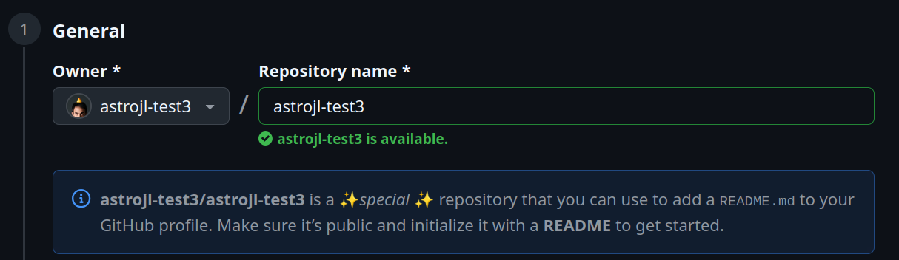
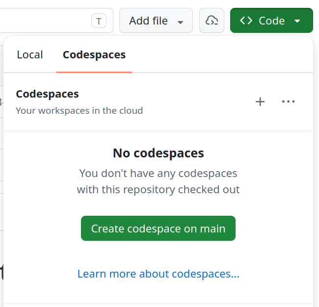
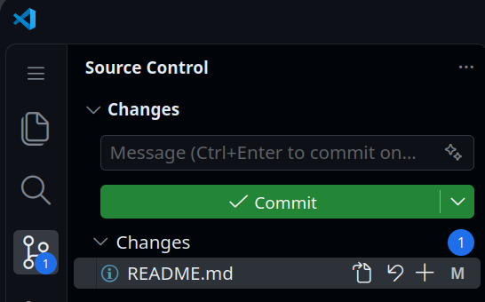
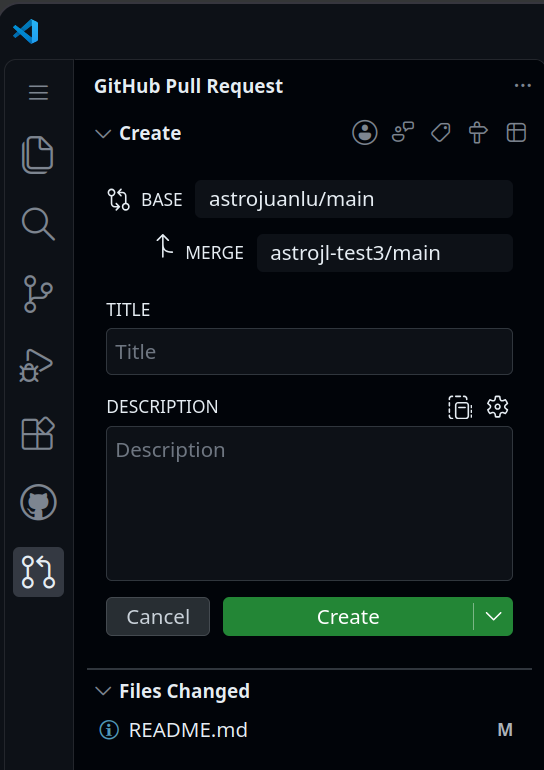
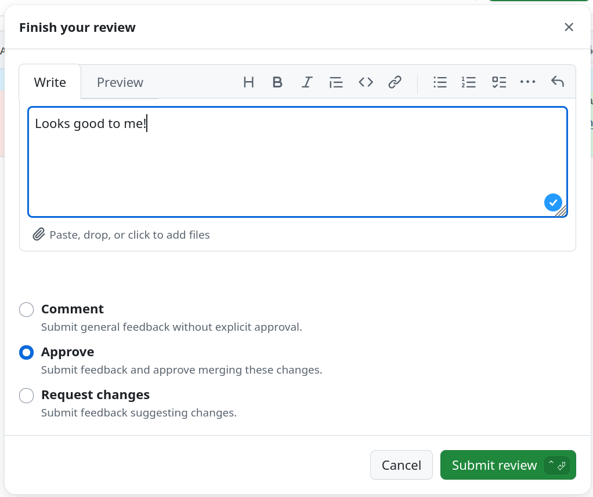
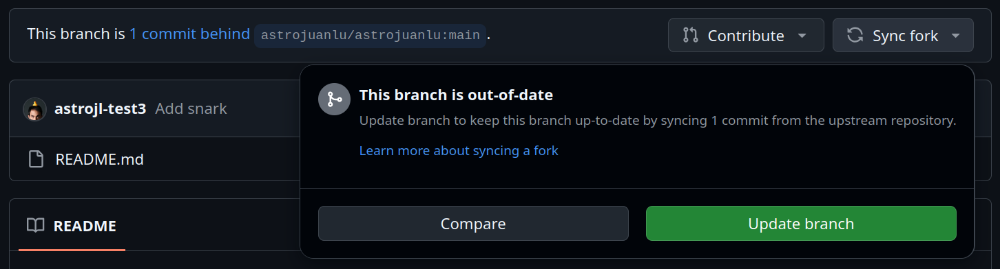
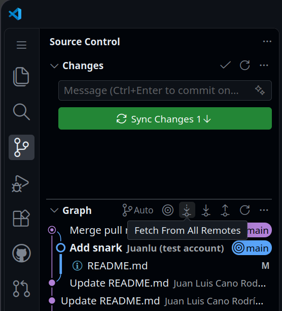

# Ejercicios, día 1

## 1. Primeros pasos con GitHub

- Ve a https://github.com/ y haz clic en "Sign up for GitHub"
- Sigue los pasos

**Completado cuando**: puedes navegar a tu perfil en `https://github.com/<tu-usuario>`

## 2. Tu primer repositorio

- Ve a https://github.com/new
- Usa tu nombre de usuario como nombre del repositorio
- Comprueba que aparece el mensaje "is a ✨special ✨ repository"
- Activa "Add README" y haz clic en "Create repository"

**Completado cuando**: tu perfil de GitHub muestra tu README personal en la parte superior

## 3. Colabora con otra persona

- Elige un README personal que no sea el tuyo
- Haz un fork del repositorio con el botón "Fork"
- En tu fork, pulsa "Code" → "Codespaces" → "Create codespace on main"

- Espera a que se abra Visual Studio Code en el navegador
- Haz cualquier cambio en el archivo `README.md`
- Haz commit y push de tu cambio con la interfaz de VS Code

- Crea una pull request con la interfaz de VS Code

- Espera a que la otra persona apruebe y mezcle tu pull request

**Completado cuando**: tu pull request se ha mezclado 🎉

## 4. Colabora una segunda vez con otra persona

> [!WARNING]
> Esto parece una tontería, pero no lo es. _Después_ de que se mezcle la primera contribución,
> hay que hacer una limpieza para poder seguir trabajando. Esta sección te guía por esos pasos.

- Entra en tu fork en GitHub, y sincroniza los cambios

- Refresca los cambios from todos los orígenes en VS Code

- Cuando se hayan refrescado los cambios, haz click en "Sync Changes" para sincronizar tu entorno de desarrollo
- Sigue los pasos del ejercicio anterior para mandar otro pull request deshaciendo los cambios y devolviendo el README a su estado original
- Cuando esté mezclado, sigue los pasos del principio de este ejercicio para sincronizar tu fork y tu entorno de desarrollo

**Completado cuando**: tu segunda pull request se ha mezclado, tu fork está al día y tu entorno de desarrollo también 🎉
