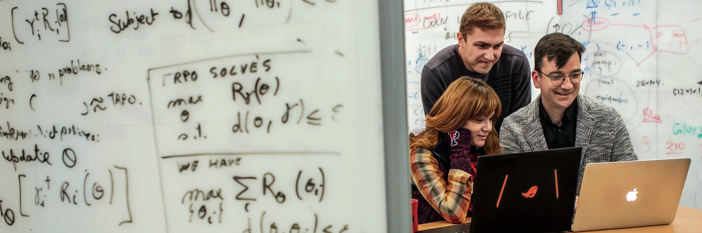

# Buenas prácticas en ciencia computacional con Python

Juan Luis Cano Rodríguez <hello@juanlu.space>

## Agenda (día 1)

- **Introducción**
  - ¿Por qué este curso?
  - Presentación
  - Temario y objetivos
- **Desarrollo colaborativo** en _GitHub_
- **Entornos de desarrollo efímeros** con _GitHub Codespaces_

Diapositivas: https://astrojuanlu.github.io/curso-ciencia-computacional/
